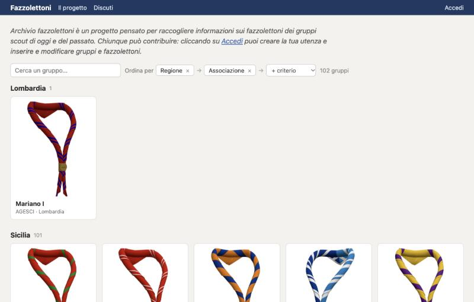
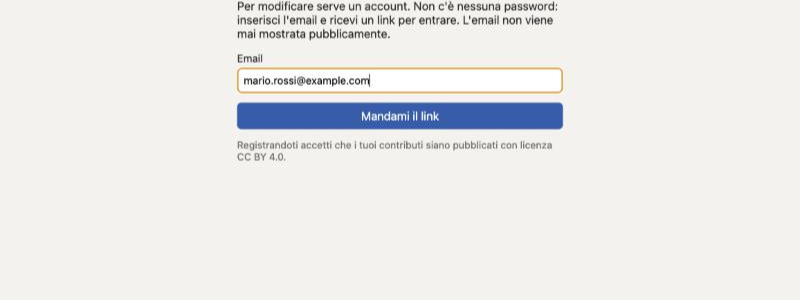
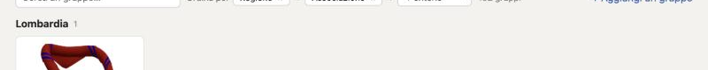
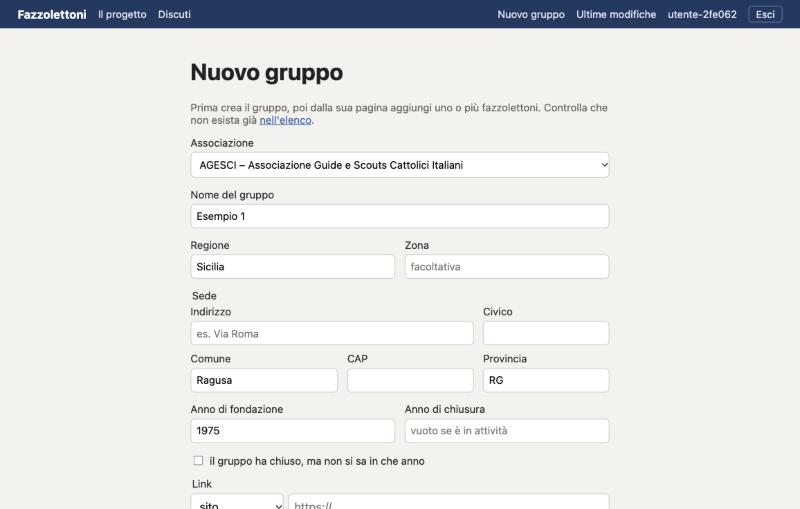
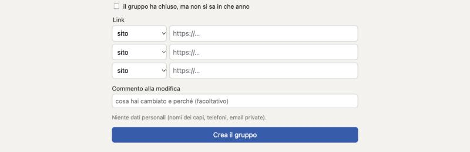
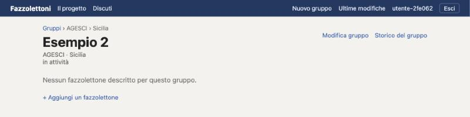
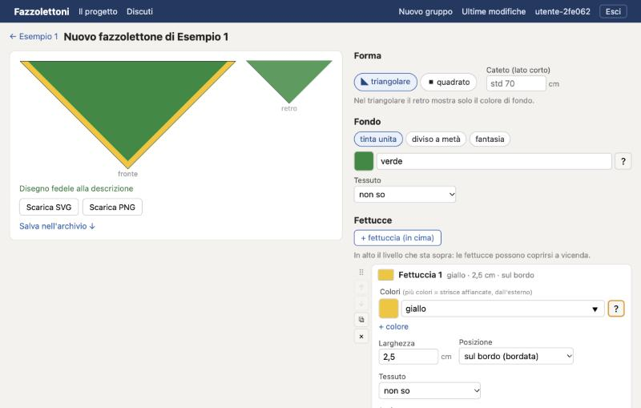
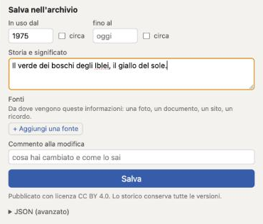
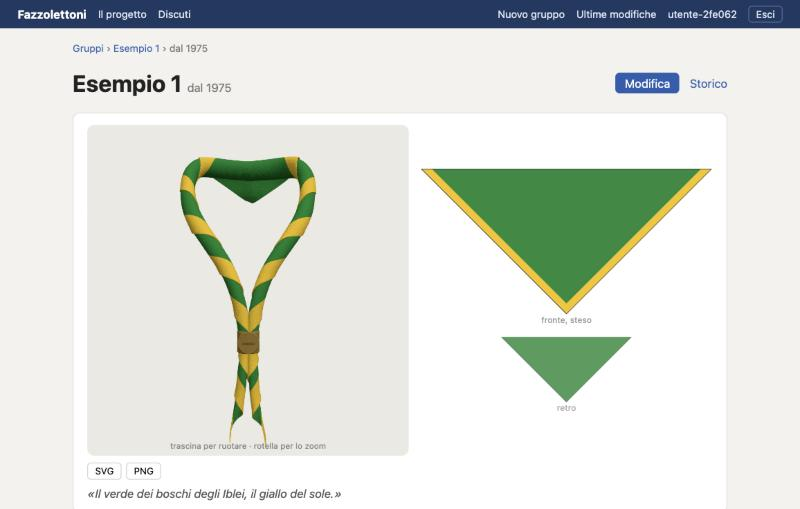

# Come aggiungere un fazzolettone

Una guida passo passo per inserire nell'archivio il fazzolettone del tuo gruppo (di oggi o del passato). Servono pochi minuti; le schermate qui sotto sono prese da un computer.

In breve: **1.** accedi con la tua email → **2.** apri il link che ricevi → **3.** crea il gruppo → **4.** disegna il fazzolettone e salva.

---

## 1. Accedi

Vai su [fazzolettoni.vercel.app](https://fazzolettoni.vercel.app) e clicca su **Accedi**, in alto a destra.

Scrivi la tua email e clicca **Mandami il link**. Non serve nessuna password e la tua email non viene mai mostrata a nessuno.

## 2. Apri il link che ti arriva per email

Il sito ti conferma di aver mandato il link.

Apri la tua casella di posta: entro un paio di minuti arriva un'email con un link per entrare. **Cliccalo dallo stesso computer e dallo stesso browser** con cui hai chiesto l'accesso.

- Non la trovi? Guarda nella cartella **spam** o **promozioni**.
- Il link vale una volta sola e scade dopo un po': se non funziona, richiedine un altro dalla pagina Accedi.

Sei dentro quando in alto a destra compaiono **Nuovo gruppo**, **Ultime modifiche** e il tuo nome utente.

## 3. Crea il gruppo

Prima di tutto **cerca il tuo gruppo nell'elenco** della home: se c'è già, aprilo e vai direttamente al punto 4.

Se non c'è, clicca **Nuovo gruppo** in alto. Compila:

- **Associazione** (AGESCI, CNGEI, FSE…);
- **Nome del gruppo**, come lo chiamate voi (es. _Ragusa 1_);
- **Regione**;
- se li sai: sede, anno di fondazione, eventuale anno di chiusura, link al sito o ai social.

In fondo clicca **Crea il gruppo**. Niente dati personali, per favore: nomi dei capi, telefoni, email private.

## 4. Aggiungi il fazzolettone

Si apre la pagina del gruppo. Clicca **+ Aggiungi un fazzolettone**.

Si apre l'editor: a sinistra vedi il disegno, a destra lo descrivi. Il disegno si aggiorna mentre scrivi.

- **Forma**: triangolare o quadrato.
- **Fondo**: tinta unita, diviso a metà o fantasia. Clicca il **quadratino colorato** per scegliere il colore e scrivi accanto il nome che usate voi (es. _verde_). Se il colore non lo sai, clicca **?**.
- **Fettucce**: per ognuna scegli colore, larghezza e posizione (sul bordo o più all'interno). Con **+ fettuccia** ne aggiungi altre.
- **Toppe, loghi e scritte**, se ci sono.

Non sai qualcosa? Lascia **non so**: è meglio un dato mancante di uno inventato, e qualcun altro potrà completarlo.

## 5. Salva

Scorri fino a **Salva nell'archivio** (o clicca il link _Salva nell'archivio ↓_ sotto il disegno) e indica:

- **In uso dal / fino al**: gli anni in cui il gruppo ha usato questo fazzolettone. Lascia vuoto _fino al_ se lo usate ancora; spunta _circa_ se l'anno è indicativo.
- **Storia e significato**: perché questi colori, da quando, cosa rappresentano.
- **Fonti**: da dove viene l'informazione (una foto, un documento, un sito, un ricordo).

Poi clicca **Salva**.

Fatto! Il fazzolettone compare nella pagina del gruppo, anche in 3D.

---

### Domande frequenti

- **Ho sbagliato qualcosa.** Nessun problema: dalla scheda clicca **Modifica** e correggi. Lo **Storico** conserva tutte le versioni, quindi non si perde niente.
- **Il gruppo ha avuto più fazzolettoni nel tempo.** Aggiungili uno per uno, ognuno con i suoi anni.
- **Ho una foto del fazzolettone.** Per ora indicala tra le fonti; se vuoi, condividila qui nelle discussioni.
- **Licenza.** Quello che inserisci è pubblicato con licenza [CC BY 4.0](https://creativecommons.org/licenses/by/4.0/deed.it): chiunque può riusarlo citando l'archivio.

Hai dubbi o qualcosa non funziona? Scrivi qui sotto!
