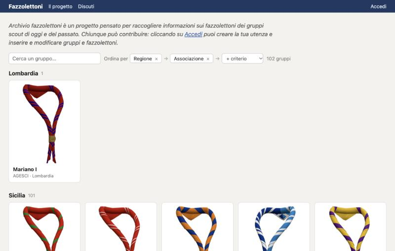
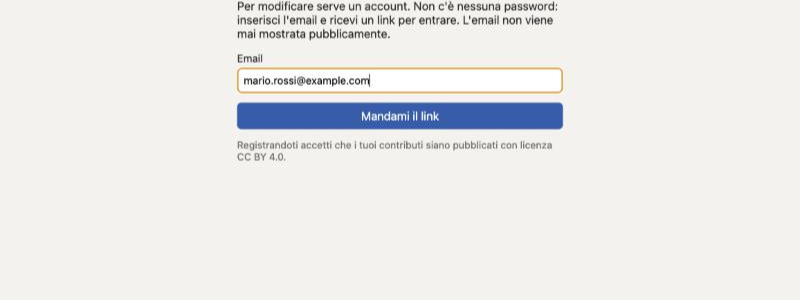
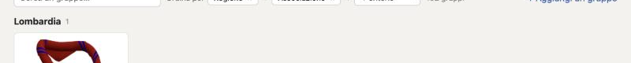
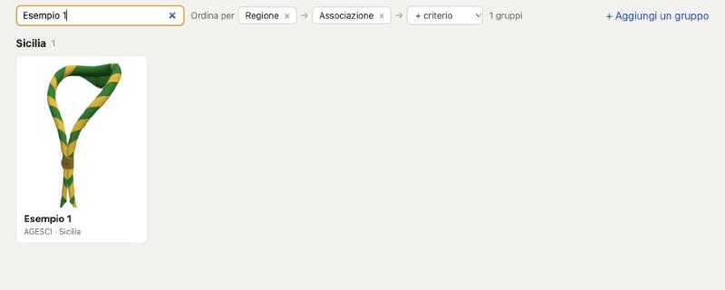
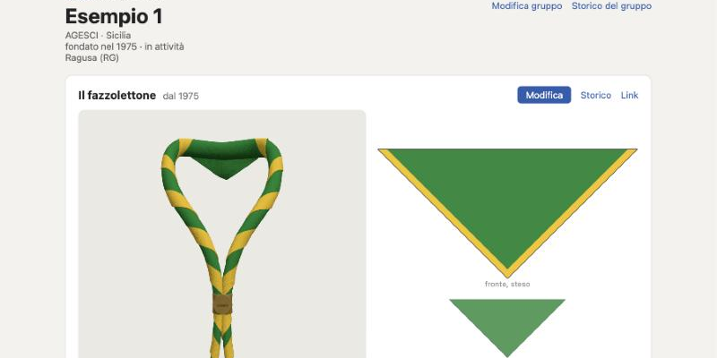
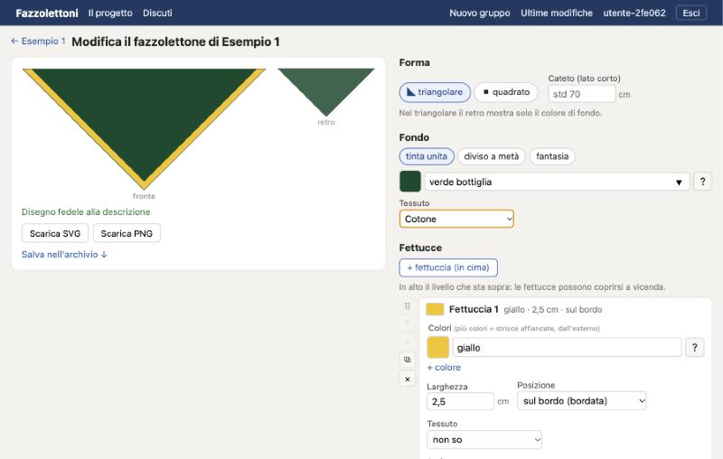
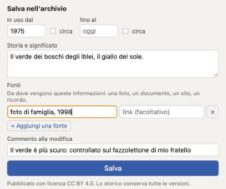
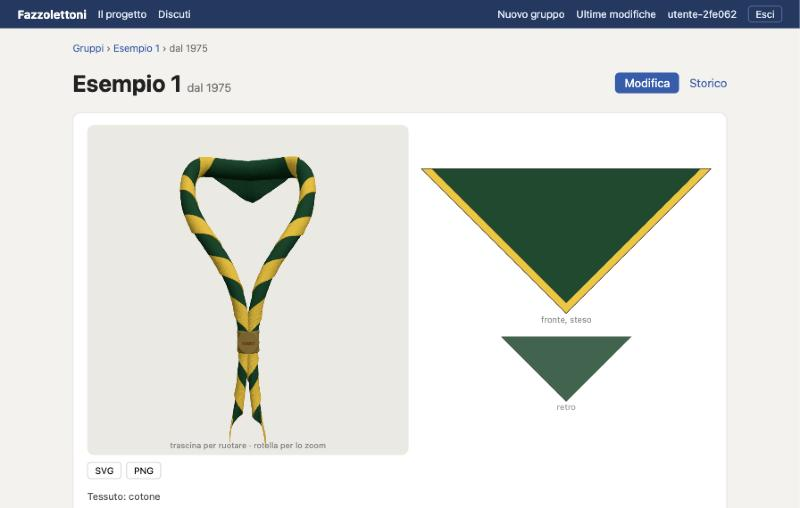
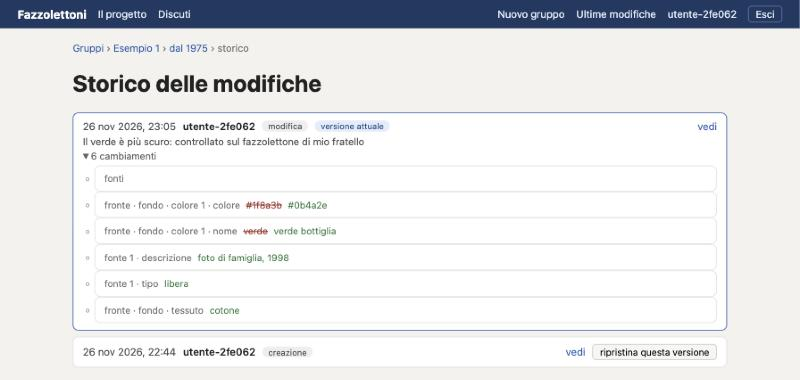

# Come modificare un fazzolettone

Hai trovato nell'archivio il fazzolettone del tuo gruppo ma c'è qualcosa che non va: un colore sbagliato, una fettuccia che manca, gli anni d'uso, la storia? Puoi correggerlo tu. Questa guida ti accompagna passo passo; le schermate sono prese da un computer.

In breve: **1.** accedi con la tua email → **2.** trova il gruppo → **3.** clicca **Modifica** → **4.** correggi → **5.** scrivi cosa hai cambiato e salva.

Non aver paura di sbagliare: **ogni versione viene conservata** e si può sempre tornare indietro.

---

## 1. Accedi

Vai su [fazzolettoni.vercel.app](https://fazzolettoni.vercel.app) e clicca su **Accedi**, in alto a destra.

Scrivi la tua email e clicca **Mandami il link**. Non serve nessuna password e la tua email non viene mai mostrata a nessuno.

Apri la tua casella di posta: entro un paio di minuti arriva un'email con un link per entrare. **Cliccalo dallo stesso computer e dallo stesso browser** con cui hai chiesto l'accesso.

- Non la trovi? Guarda nella cartella **spam** o **promozioni**.
- Il link vale una volta sola e scade dopo un po': se non funziona, richiedine un altro dalla pagina Accedi.

Sei dentro quando in alto a destra compaiono **Nuovo gruppo**, **Ultime modifiche** e il tuo nome utente.

> Puoi anche cominciare a modificare senza aver fatto l'accesso: il disegno resta salvato come bozza nel tuo browser, e al momento di salvare il sito ti chiede di accedere.

## 2. Trova il gruppo

Nella pagina principale scrivi il nome del gruppo nel campo **Cerca un gruppo…**: l'elenco si restringe mentre scrivi. Clicca sul gruppo.

## 3. Clicca «Modifica»

Nella pagina del gruppo ci sono due link che si somigliano:

- **Modifica gruppo** (in alto a destra) serve per i dati del gruppo: nome, sede, anni di attività, link.
- **Modifica** (il bottone blu sopra il fazzolettone) serve per **il fazzolettone**. È questo che ti serve.

Se il gruppo ha avuto più fazzolettoni nel tempo, ognuno ha il suo bottone **Modifica**: scegli quello giusto.

## 4. Correggi

Si apre l'editor con il fazzolettone così com'è ora: a sinistra vedi il disegno, a destra lo descrivi. Il disegno si aggiorna mentre modifichi, così vedi subito il risultato.

- **Forma**: triangolare o quadrato.
- **Fondo**: tinta unita, diviso a metà o fantasia. Clicca il **quadratino colorato** per scegliere il colore e scrivi accanto il nome che usate voi (es. _verde bottiglia_). Se il colore non lo sai, clicca **?**. Sotto puoi indicare il **tessuto**.
- **Fettucce**: per ognuna puoi cambiare colore, larghezza e posizione. Con **+ fettuccia** ne aggiungi una, con **×** la togli.
- **Toppe, loghi e scritte**, se ci sono.

Non sai qualcosa? Lascia **non so**: è meglio un dato mancante di uno inventato.

## 5. Scrivi cosa hai cambiato e salva

Scorri fino a **Salva nell'archivio** (o clicca il link _Salva nell'archivio ↓_ sotto il disegno). Qui puoi anche correggere:

- **In uso dal / fino al**: gli anni in cui il gruppo ha usato questo fazzolettone (_circa_ se l'anno è indicativo);
- **Storia e significato**;
- **Fonti**: clicca **+ Aggiungi una fonte** e scrivi da dove viene l'informazione (una foto, un documento, un sito, un ricordo), con un link se c'è.

Poi riempi il **Commento alla modifica**: una frase su cosa hai cambiato e come lo sai (es. _«il verde è più scuro: controllato su un fazzolettone vero»_). Aiuta chi verrà dopo di te a fidarsi della correzione.

Se la scheda aveva degli avvisi «da rivedere» e tu hai controllato su un fazzolettone vero, spunta la casella che li rimuove.

Infine clicca **Salva**.

Fatto! Torni alla scheda del fazzolettone, già aggiornata.

## Lo storico: niente va perso

Dalla scheda del fazzolettone clicca **Storico**. Vedi tutte le versioni, dalla più recente: chi ha modificato, quando e con quale commento. Cliccando su **cambiamenti** vedi nel dettaglio cosa è cambiato (in rosso barrato il prima, in verde il dopo).

- **vedi** mostra il fazzolettone com'era in quella versione;
- **ripristina questa versione** lo riporta com'era, se una modifica era sbagliata.

---

### Domande frequenti

- **Il fazzolettone del mio gruppo non c'è proprio.** Allora va aggiunto: segui la guida [Come aggiungere un fazzolettone](https://github.com/fazzolettoni/fazzolettoni/tree/main/docs/guida-aggiungere-fazzolettone).
- **Il gruppo ha cambiato fazzolettone nel tempo.** Non sovrascrivere quello vecchio: dalla pagina del gruppo clicca **+ Aggiungi un altro fazzolettone** e inserisci quello nuovo con i suoi anni. Nel vecchio, compila _fino al_.
- **Ho chiuso la pagina prima di salvare.** Il disegno resta come bozza nel tuo browser: riapri **Modifica** sullo stesso fazzolettone e lo ritrovi. Anni, storia, fonti e commento invece vanno riscritti.
- **Non sono d'accordo con una modifica di qualcun altro.** Guarda lo storico e il commento; se serve ripristina la versione precedente, oppure scrivi qui nelle discussioni.
- **Licenza.** Quello che inserisci è pubblicato con licenza [CC BY 4.0](https://creativecommons.org/licenses/by/4.0/deed.it): chiunque può riusarlo citando l'archivio.

Hai dubbi o qualcosa non funziona? Scrivi qui sotto!
